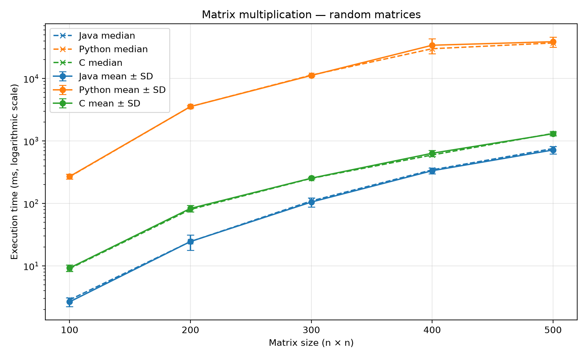
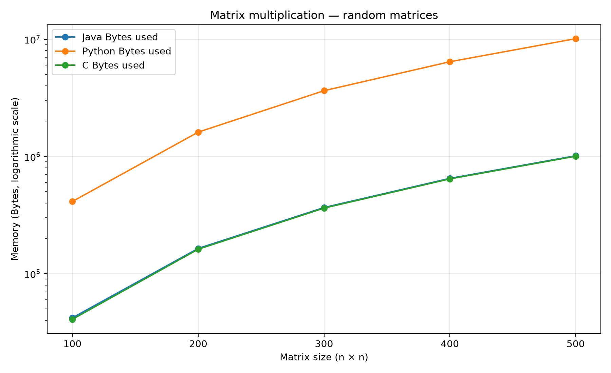
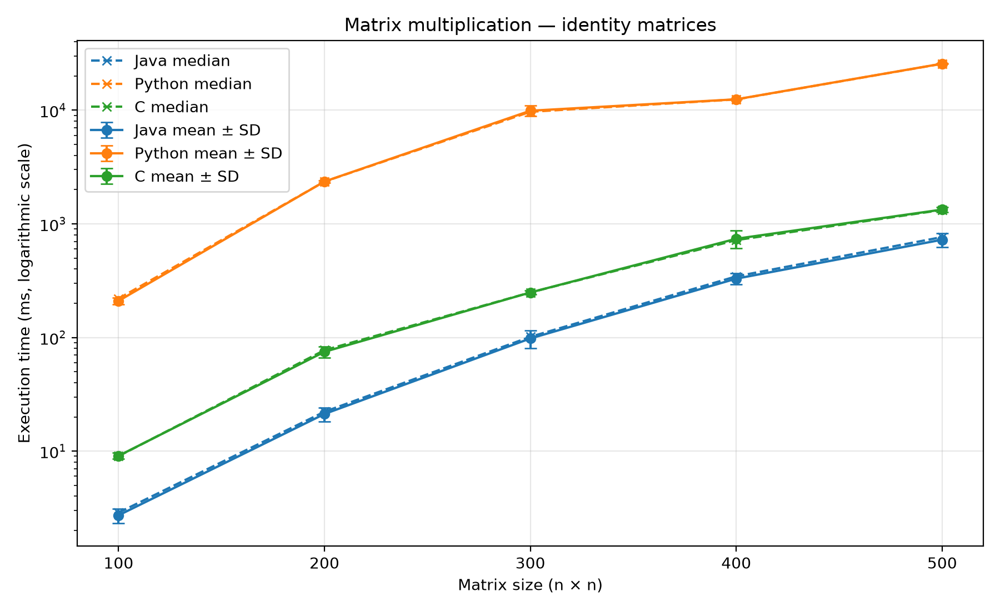
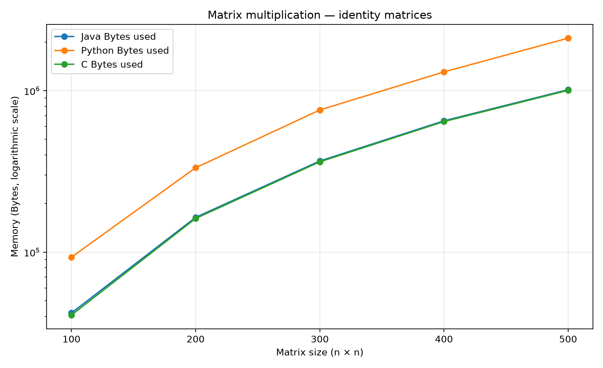
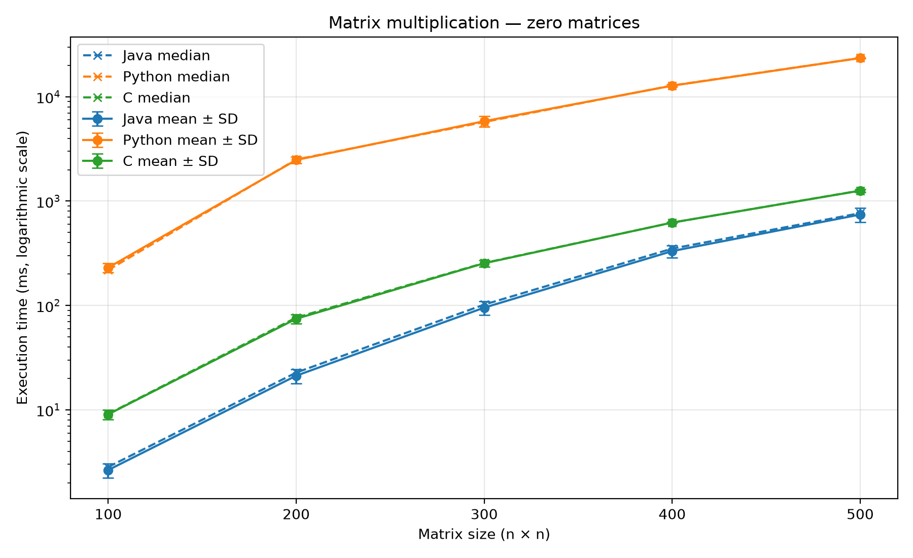
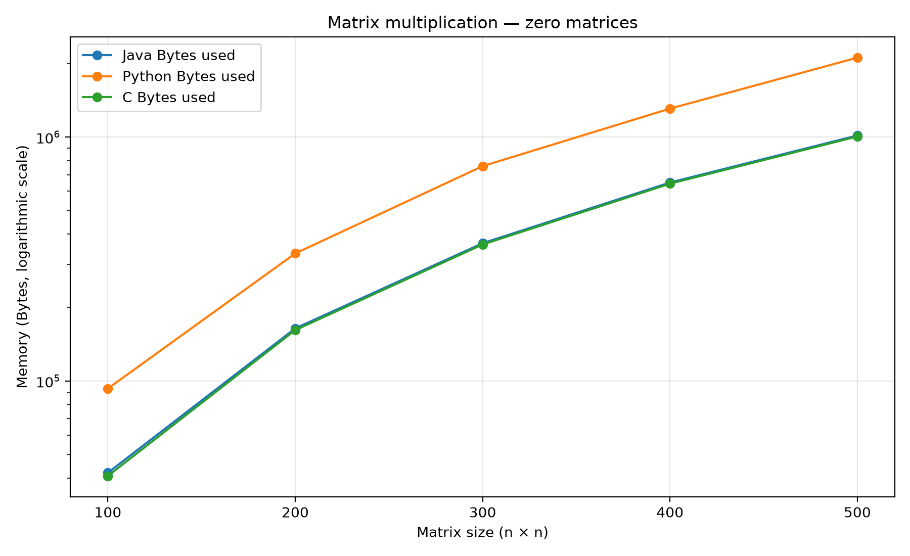

# Basic Matrix Multiplication in Python, Java and C

This project compares straightforward dense matrix multiplication implemented in **Python, Java and C**. The implementations use the conventional three-loop algorithm, with cubic arithmetic complexity, **O(n³)**. The experiments measure execution time and a memory-related metric for random, identity and zero matrices at several matrix sizes.

## Project structure

The repository contains the three language implementations and a Python results plotter.

```text
-Basic-Implementation-of-Matrix-Multiplication/
├── Java Matrix Multiplication/       # Java implementation and JMH benchmark
├── Python Matrix Multiplication/     # Python implementation and benchmark
├── C Matrix Multiplication/          # C implementation and benchmark
├── Results Plotter/                  # Python plotter of CSV results
├── java_results.csv                  # Generated by the Java benchmark
├── python_results.csv                # Generated by the Python benchmark
├── c_results.csv                     # Generated by the C benchmark
├── results/
│   ├── combined_results.csv          # Generated by the plotter
│   └── plots/                        # Generated PNG figures
└── README.md
```

The three input CSV files must be in the **repository root**, alongside this README. Configure the working directory of each IDE run configuration accordingly before running the plotter.

## Implementations

Each implementation multiplies two dense square matrices using three nested loops. The result matrix is created by the multiplication method. Input matrix generation takes place outside the timed region, so the benchmark focuses on multiplication and result-matrix allocation rather than input generation. Output printing is not part of the timed region.

The benchmark cases are:

- `random`: multiplication of two generated matrices.
- `identity`: multiplication of an identity matrix by itself.
- `zero`: multiplication of a zero matrix by itself.

The configured matrix sizes may differ between implementations. The plots show the sizes that are present in each CSV; for a direct comparison, run all three languages at the same feasible sizes.

## Requirements

- **Java:** a JDK compatible with the Java project (ms-21 recommended) and its Maven configuration; JMH dependencies are used for the Java benchmark.
- **Python:** Python 3.10 or newer is recommended for the type-hint syntax used in this project.
- **Python plotting dependency:** Matplotlib.
- **C:** a C compiler supported by CMake (the project has been developed with CLion and MinGW on Windows).
- **Plotter:** access to `java_results.csv`, `python_results.csv` and `c_results.csv` in the repository root.

Install the plotting dependency with:

```bash
python -m pip install matplotlib
```

## How to run the benchmarks

Run each benchmark separately. Make sure each program writes its output CSV to the repository root.

### Java

1. Open the project in IntelliJ IDEA.
2. Ensure the Maven project resolves its JMH dependencies.
3. Run `BenchmarkMain` in `Java Matrix Multiplication/src/test/java/benchmark`.

The Java benchmark uses JMH with one warm-up iteration, five measurement iterations, a one-second warm-up duration, a one-second measurement duration and one fork. The GC profiler is enabled to obtain the allocation metric.

### Python

1. Open the project in PyCharm.
2. Run `benchmark_main.py` in `Python Matrix Multiplication/test`.

The Python benchmark uses one warm-up run and five measured runs per configuration.

### C

1. Open the project in CLion.
2. Reload the CMake project.
3. Select the benchmark executable target `Matrix_Benchmark_C`.
4. Select the repository root as the working directory so the file is written there.
5. Run `Matrix_Benchmark_C`.

The C benchmark uses one warm-up run and five measured runs per configuration.

## Generate the combined CSV and plots

1. Install MatplotLib if you haven't already.
2. Run `main.py` in `Results Plotter/main`.

The plotter reads the three CSV files from the repository root and generates:

- `results/combined_results.csv`: all rows combined and sorted by benchmark, matrix size and language.
- `results/plots/time_comparison_random.png`: random-matrix timings plot.
- `results/plots/time_comparison_identity.png`: identity-matrix timings plot.
- `results/plots/time_comparison_zero.png`: zero-matrix timings plot.

The Y-axis uses a logarithmic scale.

## CSV format

All three input CSV files use the same columns, in this order:

```csv
language,benchmark,matrix_size,mean_time,median_time,variance_time,peak_memory_bytes
```

- `language`: `Java`, `Python` or `C`.
- `benchmark`: `random`, `identity` or `zero`.
- `matrix_size`: side length `n` of the `n × n` matrix.
- `mean_time`: mean execution time in milliseconds (ms).
- `median_time`: median execution time in milliseconds (ms).
- `variance_time`: sample variance of the measured execution times in milliseconds squared (ms²).
- `peak_memory_bytes`: the memory-related value recorded by that implementation, in bytes.

The plotter represents the mean with error bars of **± one standard deviation**, and the median as a dashed line.

## Memory metric and limitations

The `peak_memory_bytes` column has the same name in every CSV, but the underlying metric must be interpreted according to the implementation:

- **Java:** `GCProfiler`'s `gc.alloc.rate.norm` reports bytes allocated per operation (`B/op`).
- **Python:** `tracemalloc` reports the peak Python memory traced during the multiplication.
- **C:** the calculation estimates the result matrix's storage (row pointers plus integer elements). It does not measure the process's actual peak memory and excludes allocator metadata and the input matrices.

These measurements are **not directly equivalent** and are not a strict cross-language comparison of peak process memory.

## Experimental protocol and reproducibility

### Input generation

All implementations use dense square integer matrices with values in the range `[0, 99]`. The random seed is set to `777` in each language. However, Java, Python and C use different random-number generators, so using the same seed does not guarantee identical input matrices across languages.

Three benchmark cases are evaluated: random matrices, identity matrices and zero matrices. Input generation takes place outside the timed multiplication operation.

### Timing protocol

The Java implementation uses JMH with one warm-up iteration of one second, five measurement iterations of one second each, and one fork. The Python and C implementations use one warm-up execution and five measured executions per configuration.

The reported mean, median and sample variance are calculated from the measured times.

The timed operation includes the creation and initialization of the result matrix. Input generation and console output are excluded from the timed region.

### Matrix sizes

The Java, Python and C benchmarks are configured to test matrix sizes `100`, `200`, `300`, `400` and `500`.

Comparisons between languages are made at matrix sizes available in the corresponding result files.

### Correctness

The identity and zero matrices return the expected results.

```text
1  0     1  0    0  0     0  0
      =                =
0  1     0  1    0  0     0  0
```

## Environment used

| Item | Value |
|---|---|
| Operating system and version | Windows 11 Home 25H2 |
| CPU model | 11th Gen Intel(R) Core(TM) i5-11400H @ 2.70GHz |
| Physical cores / logical processors | 6 / 12 |
| Installed RAM | 7,65 GB |
| Java JDK version | 21.0.12.1 |
| JMH version | 1.37 |
| Python version | 3.12.10 |
| Matplotlib version | 3.11.2 |
| C compiler and version | MinGW-w64 15.2.0 |
| CMake version | 4.3.1 |
| C build configuration and optimization flags | Debug; -g; no explicit optimization flags |

## Plots

The figures below are generated when the plotter runs.

### Random matrices





### Identity matrices





### Zero matrices





## Repository and submission contents

The submission include the source code for the three implementations and the plotter, their configuration/build files, this README and the generated figures.

## AI assistance disclosure

> **AI tool:** Chat GPT
>
> **Purpose:** Improve redaction, speed up code writing
>
> **Parts affected:** Different parts of the code, README and report
>
> **Validation:** The code was refactored and rewritten after use, the README and report were initially handwritten and then checked
